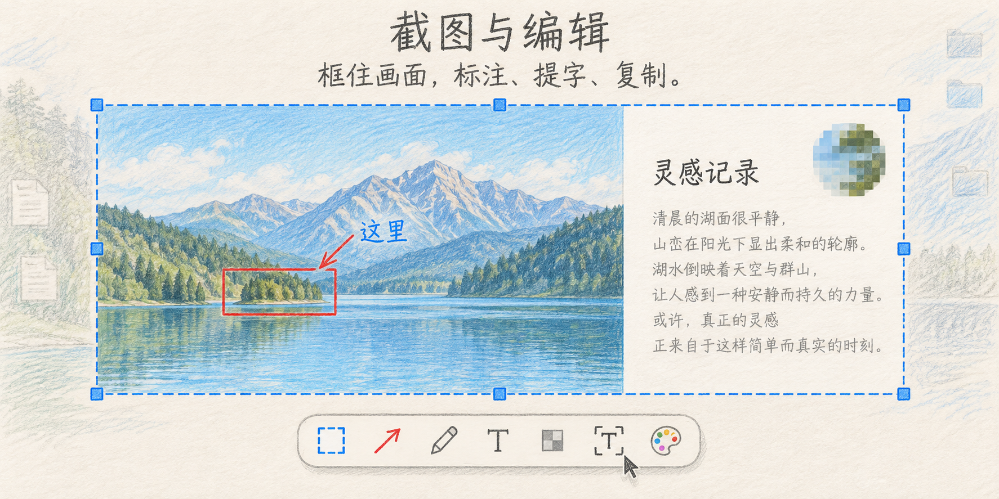
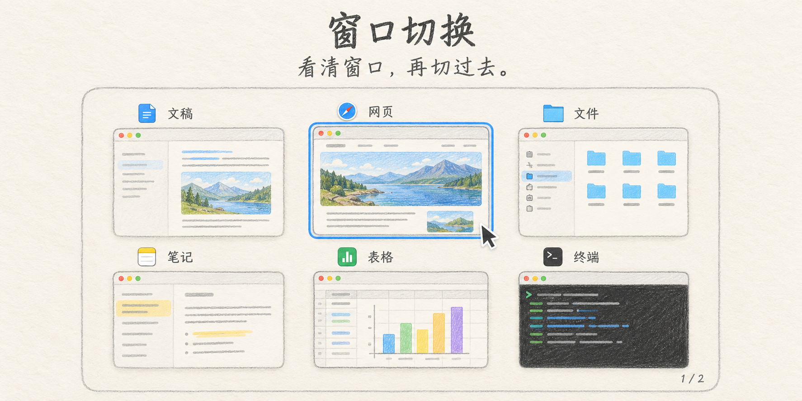
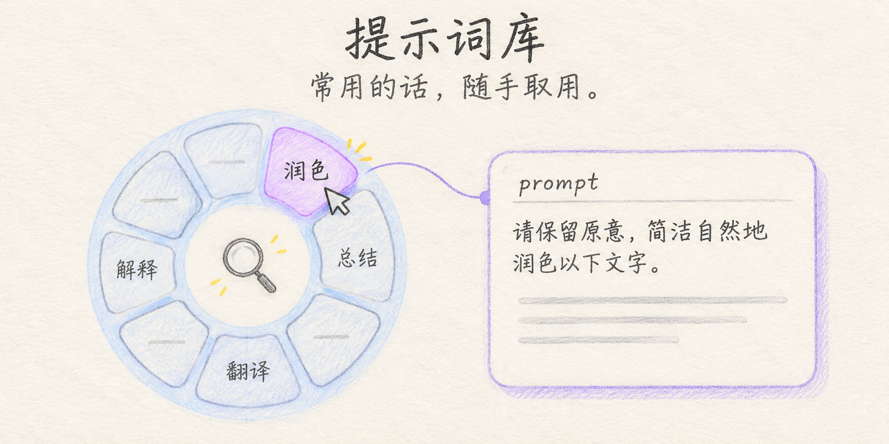
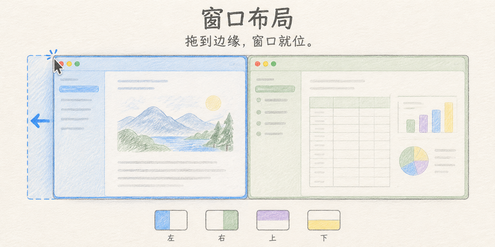
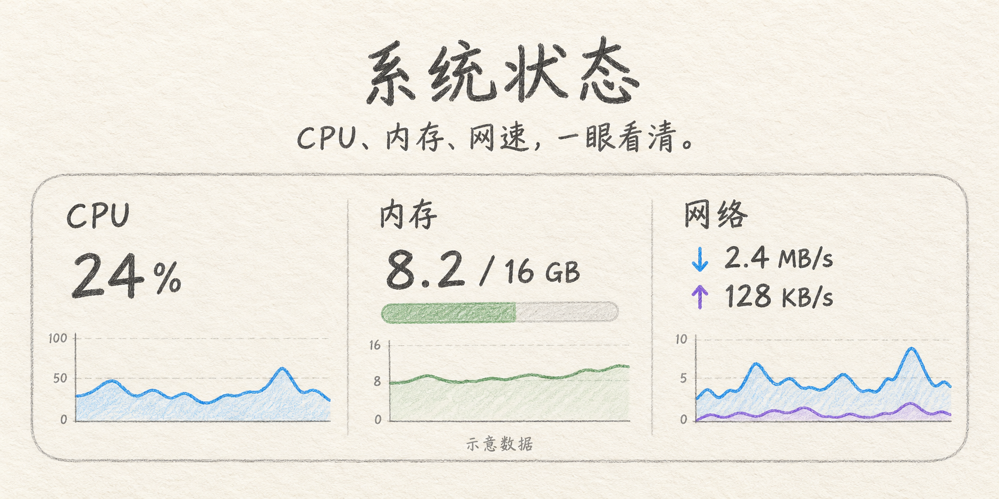

  

  <a href="https://github.com/anjing-le/macos-x/releases/latest">下载最新版</a> ·
  <a href="#安装与更新">安装与更新</a> ·
  <a href="#默认快捷键">默认快捷键</a> ·
  <a href="https://github.com/anjing-le/macos-x/issues">反馈问题</a>

macos-x 是一个常驻菜单栏的原生 macOS 工具箱。通过功能池添加或移除功能入口，独立开关、拖动排序，按自己的习惯组合；移除入口会保留设置与内容。

[截图录屏](#截图录屏) · [窗口切换](#窗口切换) · [提示词库](#提示词库) · [窗口布局](#窗口布局) · [菜单栏收纳](#菜单栏收纳) · [系统状态](#系统状态) · [快捷键雷达](#快捷键雷达)

## 截图录屏

默认 **F1** 定格并选取画面；在截图中用 **⌘C** 复制图片、**⌘T** 提取文字。支持原位文字编辑、标注、马赛克与撤销重做。

**F3** 将剪贴板中的图片或文字贴在屏幕上，可拖动、缩放和编辑。**F4** 将当前图像收进晾衣杆，悬停查看；左右键选图、**⌘C** 复制，还能沿绳子调整位置。

默认 **⌃⇧T** 框选录屏区域，**Enter** 开始，再按同一快捷键停止并保存 MP4。系统声音与麦克风在设置中分别选择，默认关闭。

## 窗口切换

用 **⌘Tab** 查看并切换具体窗口。支持两行分页与可滚动的全部视图，缩略图帮助你在文稿、网页和其他窗口之间找到目标。

## 提示词库

默认**双击右 Option** 呼出，选择后复制保存的提示词。支持轮盘或清单、搜索、常用位置拖放，以及 JSON 导入导出。

## 窗口布局

拖到屏幕边缘吸附，四角可放到四分之一屏。**⌥⌘← / → / ↑ / ↓** 分别对应左、右、上、下半屏。

## 菜单栏收纳

按住 **⌘** 拖动原图标：苹果左侧收纳、右侧常驻。悬停苹果展开，离开菜单栏区域 **5 秒**后收起；操作原生菜单期间保持展开。

## 系统状态

在应用内查看本机 CPU、内存和网速，每两秒刷新，保留最近一分钟曲线。图中为示意数据，运行时读取本机实际状态。

## 快捷键雷达

按需检测并搜索组合键、应用和用途，查看系统登记、运行中应用公开菜单及本工具已启用的热键。

排行按**已知用途数量**排列，不等同于真实冲突频率；应用自行监听、未公开的热键可能无法识别。

## 默认快捷键

展开查看

| 操作 | 默认快捷键 |
| --- | --- |
| 截图 | F1 |
| 截图内复制图片并退出 | ⌘C |
| 截图内提取文字 | ⌘T |
| 贴图 | F3 |
| 显示／隐藏贴图 | ⇧F3 |
| 收纳到晾衣杆 | F4 |
| 晾衣杆选图／复制／删除 | ← → / ⌘C / ⌘⌫ |
| 区域录屏／停止录屏 | ⌃⇧T |
| 窗口切换 | ⌘Tab |
| 提示词库 | 双击右 Option |
| 左／右／上／下半屏 | ⌥⌘← / → / ↑ / ↓ |

⌘ Command · ⌥ Option · ⌃ Control · ⇧ Shift。可配置的快捷键可在对应模块设置中修改；功能键是否需要配合 Fn，取决于系统键盘设置。

## 安装与更新

1. 在 [最新版本](https://github.com/anjing-le/macos-x/releases/latest) 中下载 **DMG**，打开后将 **MacOSX** 拖入“应用程序”。
2. 启动后从菜单栏苹果进入：**双击打开主界面，右键打开菜单**。在功能池选择需要的工具，使用相关功能时按提示授予权限。
3. 后续通过应用内“检查更新”下载并确认安装；**ZIP** 用于 OTA 更新分发。

系统要求 **macOS 14+**；当前发行包为 **Apple Silicon（arm64）**。菜单栏图示对应 macOS 27 的原生收纳方式，较早系统采用边界收纳方式。

窗口操作、菜单栏收纳和应用菜单检测需要辅助功能权限；截图录屏与窗口缩略图使用屏幕录制权限；麦克风仅在选择录制麦克风时申请。
